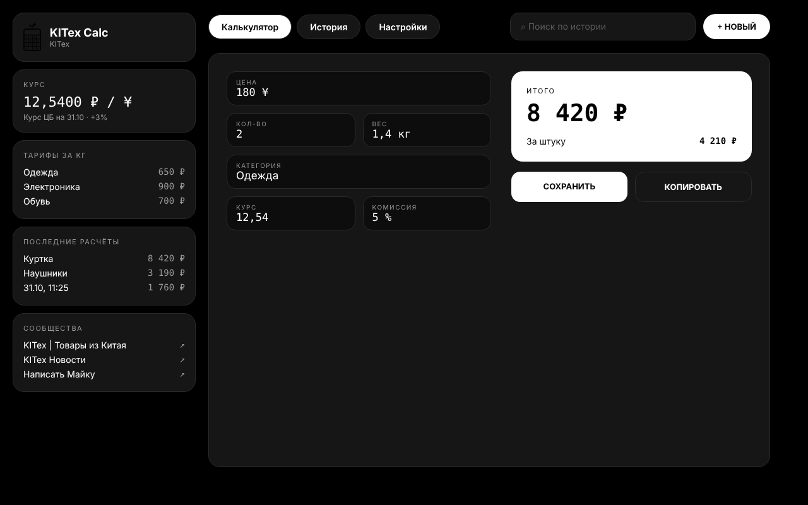

<div align="center">

# KITex Calc

**Калькулятор конечной стоимости товаров из Китая в рублях.**
Работает без интернета. Android, Windows, macOS, Linux.

`цена в ¥ × количество × курс + комиссия посредника + доставка по весу + доп. расходы`

</div>

---

## Что это

Приложение, которым пользуется торговая сеть **KITex**: вводишь цену в юанях, количество, вес и категорию, и сразу видишь итог в рублях и стоимость за штуку. Расчёты сохраняются в историю, их можно открыть обратно и отправить клиенту.

Калькулятор можно взять себе: любой перевозчик задаёт **свой курс, комиссию, тарифы по категориям и название компании**, и они попадают в подписи к расчётам.

## Возможности

- Итог в рублях и цена за штуку, пересчёт на лету
- Курс: вручную или автоматически по ЦБ РФ + ваша наценка
- Категории с тарифом ₽/кг: свои, редактируемые
- История с поиском; тап по расчёту открывает окно «Вставить в калькулятор»
- Отправка расчёта: «Поделиться» на телефоне, копирование на ПК
- Название и контакт вашей компании в тексте расчёта
- Тёмная и светлая тема, чёрно-белый стиль KITex
- Всё хранится на устройстве (SQLite), без аккаунтов и серверов

## Версия для ПК

Окно шире 900 px переключается на раскладку в духе веб-кабинета: слева колонка (бренд, курс, тарифы, последние расчёты, сообщества), сверху вкладки, поиск и «+ Новый», справа большая карточка с полями и чеком. Узкое окно и телефон используют нижнюю навигацию.



## Скачать

Готовые сборки лежат в [Releases](../../releases): `.apk` для Android, `.zip` для Windows и macOS, `.tar.gz` для Linux.

> Сборки пока не подписаны: Windows покажет SmartScreen («Подробнее → Выполнить в любом случае»), macOS попросит открыть через правый клик → «Открыть».

## Запуск из исходников

Нужен [Flutter](https://docs.flutter.dev/get-started/install) 3.44+.

```bash
flutter pub get
flutter run -d windows   # или macos, linux, или устройство Android
```

| Система | Что установить |
|---|---|
| Windows | Visual Studio с нагрузкой «Desktop development with C++» |
| macOS | Xcode |
| Linux | `clang cmake ninja-build pkg-config libgtk-3-dev liblzma-dev` |
| Android | Android Studio |

Каждую систему нужно собирать на ней самой. Чтобы не держать три компьютера, есть автосборка: вкладка **Actions → Release → Run workflow** собирает все четыре версии, а тег `v1.0.0` ещё и прикрепляет файлы к релизу.

```bash
flutter analyze
flutter test
flutter build windows --release   # build apk / macos / linux
```

## Как подстроить под себя

| Что | Где |
|---|---|
| Курс, комиссия, наценка, тарифы, название компании | в приложении: **Настройки** |
| Ссылки на сообщества и имя приложения | `lib/core/app_config.dart` |
| Цвета и шрифты | `lib/ui/theme/` |
| Знак и иконки | `assets/brand/` |

## Устройство проекта

```
UI  →  Controller (ChangeNotifier)  →  Repository  →  Dao / Api  →  SQLite / HTTP
```

```
lib/
  core/      константы, форматирование, платформа
  data/      модели, база, репозитории, API курса ЦБ
  domain/    формула расчёта (чистый Dart, покрыта тестами)
  ui/        calc · history · settings · shell (телефон и ПК) · common · theme
```

Подробное описание архитектуры и дизайна: папка [`docs/`](docs/).

## Подпись Android-релиза

Ключ подписи **не хранится в репозитории**. Инструкция в [RELEASE.md](RELEASE.md). Для автосборки с подписью добавьте секреты репозитория `ANDROID_KEYSTORE_BASE64`, `ANDROID_STORE_PASSWORD`, `ANDROID_KEY_PASSWORD`, `ANDROID_KEY_ALIAS`.

## KITex

Фильтр, а не магазин: товары из Китая, расчёт, доставка. Менеджер: [@KITex_Mickey](https://t.me/KITex_Mickey).

## Лицензия

Пока не указана: добавьте файл `LICENSE`, когда решите, на каких условиях делиться кодом.
